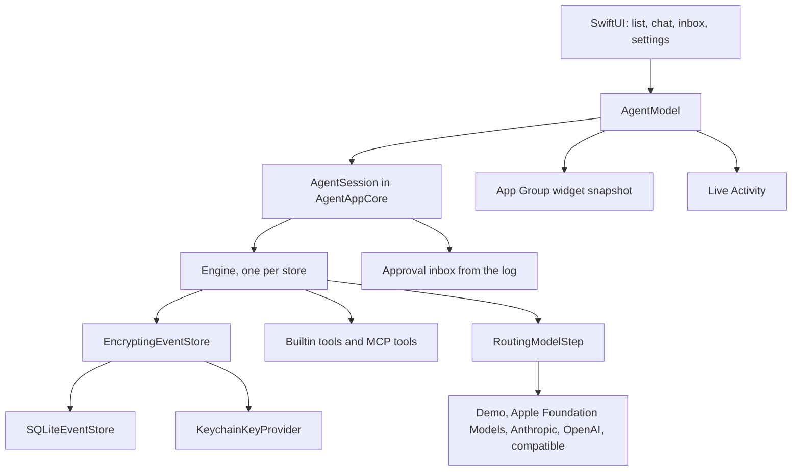

# Lumen

Lumen is a personal agent for iOS 26, iPadOS 26, and macOS 26. Each conversation is a durable run. Closing the app does not forget an in-flight tool call or an approval that is still waiting.

The Xcode project is `Apps/Agent/Lumen.xcodeproj`. Open it in Xcode 26, pick the Lumen scheme, and press Run. The project references this repository's Swift package. There is no generator step and no extra signing setup beyond Xcode's automatic signing. The first launch may ask Xcode to register the App Group `group.dev.thinkdefinecreate.Lumen`. If that fails, see `TESTING.md`.

## Architecture

One `Engine` owns the store lease. Creating a second `ConversationModel` on the same file would fail that lease, so the app does not. Changing the tool list, including a new MCP server, closes the engine and opens a new one, then calls `recover()`.

The model step must not call the engine. Streaming text is written to a separate `LiveTranscript` actor while `AgentLoopStep` is inside the engine lock. The chat polls that actor.

## Feature map

| Screen | Package feature |
|---|---|
| Agent list, create, archive | `AgentDirectory` sidecar next to the sqlite file. Archive is not an event. |
| Fork | `Engine.fork` |
| Chat send | `Engine.submitTurn` through `RoutingModelStep` and `AgentLoopStep` |
| Recovered banner | `Engine.recover` on launch. The banner shows when that returns any action. |
| Provider picker | `ProviderChoice`: scripted demo, Apple, Anthropic Messages, OpenAI Responses, OpenAI-compatible chat (`xAI`, `Groq`, `OpenRouter`, `Ollama` base URLs) |
| Live reply | `PublishingProvider` and `LiveTranscript` |
| Web fetch | `web.fetch`, idempotent, HTTPS allowlist, HTTP only for localhost |
| Reminders | `notes.reminder`, idempotent, approval before the write |
| Calendar read | `calendar.read`, pure |
| Calendar write | `calendar.write`, external, reconcile by effect key, approval |
| Contacts | `contacts.search`, pure |
| Document text | `document.ocr`, pure, Vision on device |
| Voice | Speech framework in the app. The recognized string is a normal user message. |
| MCP manager | `MCPClientSession.connect` and `MCPToolBridge.makeTools`. Empty allowlist attaches nothing. stdio only where `MCPPlatform.stdioAvailable` is true. |
| Approvals | `approval.requested` events, `Engine.resume` |
| High-risk approve | `AuthenticationLevel.biometric` after `LAContext` |
| Event log | `Engine.events` |
| Audit share | `AuditExport.jsonl` and `EventHashChain.inspect` |
| Usage | Token counts on `model.step.planned`. The dollar figure is an illustration, not a bill. |
| On-device only | `PolicyBox`. Blocks cloud providers, web fetch, and HTTP MCP. |
| Redaction, hold, purge | `BuiltInRedactor`, `Retention.hold`, `Retention.purge` |
| Delete permanently | `ConversationKeyProvider.shred` plus `EncryptingEventStore(omitShredded: true)` |
| Widget | `WidgetSnapshot` JSON in the App Group |
| Loopback MCP | `DurableMCPServer` on `127.0.0.1`, macOS and Linux |
| OpenTelemetry field | A string in settings. No OTLP client is linked. |
| CloudKit | Not implemented. |

## Setup

1. Open `Apps/Agent/Lumen.xcodeproj`.
2. Select the Lumen target, Signing & Capabilities, and choose your team. Automatic signing is enough.
3. Run on a My Mac destination, an iOS 26 simulator, or a device.
4. Finish onboarding. Keys are optional. Leave them blank to stay on the offline demo.
5. Create an agent. Send "hello" for a demo reply, or "remind me to file the receipt" to hit the reminder tool and the approval inbox.

API keys are Keychain items. The account names are `ANTHROPIC_API_KEY` and `OPENAI_API_KEY`. The journal stores the account name only when a provider is selected, never the secret.

On-device Apple Intelligence needs a device where `SystemLanguageModel` is available. If the Foundation Models framework is not linked, that provider falls back to the offline demo and the reply says so.

## Entitlements, Info.plist, capabilities

Checked in:

- `Config/Lumen.entitlements`: App Group `group.dev.thinkdefinecreate.Lumen` for the widget snapshot and the widget extension. The same file is on the app and the widget.
- `Config/Info.plist`: usage strings, background modes, Live Activities, and background task identifiers.
- `Config/WidgetInfo.plist`: WidgetKit extension point.

| Key or capability | Why |
|---|---|
| App Groups | Widget and app share `lumen-widget.json`. |
| `NSSupportsLiveActivities` | Local Live Activity and Dynamic Island. No push entitlement. |
| `UIBackgroundModes` `fetch` and `processing` | `BGAppRefreshTask` and `BGContinuedProcessingTask`. |
| `BGTaskSchedulerPermittedIdentifiers` | `dev.thinkdefinecreate.Lumen.refresh`, `dev.thinkdefinecreate.Lumen.continue`. |
| `NSCalendarsFullAccessUsageDescription` | EventKit full calendar access. |
| `NSRemindersFullAccessUsageDescription` | EventKit full reminders access. |
| `NSContactsUsageDescription` | Contact search. |
| `NSSpeechRecognitionUsageDescription` and `NSMicrophoneUsageDescription` | Dictation. |
| `NSCameraUsageDescription` | Document camera. |
| `NSFaceIDUsageDescription` | App lock and high-risk approvals. |

Remote push (`aps-environment`) is intentionally absent so automatic signing can succeed without a push capability. Approval alerts are local notifications with Approve and Deny actions. A later build can add push.

The app is not sandboxed. That keeps Keychain and outbound model calls working on the first Mac run. If you turn on the App Sandbox later, add network client and the App Group, and expect a Keychain access group.

CloudKit is a follow-up. There is no `com.apple.developer.icloud-services` entitlement.

## What stays in the package

`AgentAppCore` is what Linux `swift test` runs. The SwiftUI target, EventKit, Contacts, Vision, Speech, LocalAuthentication, ActivityKit, App Intents, BackgroundTasks, and the widget are Apple-only. They were not compiled in this environment. See `UNVERIFIED.md`.
