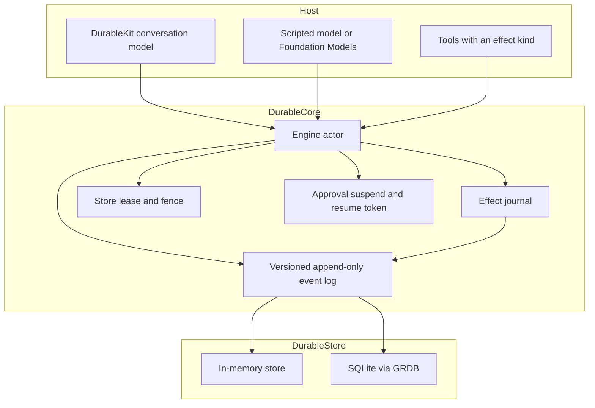

# DurableAgents

Working name: **PiSwift**.

DurableAgents is a Swift-native durable execution kernel for agent runs. The event log is the source of truth. A conversation runs under a single-owner lease, tool calls declare what kind of side effect they are, and a crash resumes from the journal instead of asking a model what happened.

The package builds and tests on Linux. The sample iOS app, Escrow Assistant, can also call Apple's on-device Foundation Models framework when the device has Apple Intelligence. That call still goes through the effect journal.

It is inspired by [Pi](https://github.com/earendil-works/pi) and Pi Durable (MIT, Copyright (c) 2025 Mario Zechner). This is an original Swift redesign, not a port of that codebase, and it is not affiliated with Earendil. Do not call this product Pi.

## Layout

| Target | Role |
|---|---|
| `DurableCore` | Event log, lease, effect journal, scripted runs, and the `ModelStep` protocol. No database and no Apple SDK. |
| `DurableStore` | `EventStore`: in-memory, and SQLite through [GRDB](https://github.com/groue/GRDB.swift). |
| `DurableKit` | `@MainActor` conversation model for SwiftUI: messages, run status, pending approval, event log. Observation is used when the SDK has it. |
| `DurableFoundationModels` | `FoundationModelsStep` when the Apple framework is present. On Linux this target is a stub. |
| `PiAI` | Provider streaming for Anthropic Messages, OpenAI Responses, and OpenAI-compatible chat. Keys stay in a secret store. |
| `PiAgent` | Multi-step loop on the engine: one journaled model checkpoint, parallel safe tools, subagents, forks, compaction. |
| `CrashProbe` | Small executable the tests kill or restart against a real SQLite file. |
| `Examples/EscrowAssistant` | iOS 26 SwiftUI app. Open the Xcode project and run it. |
| `DurableDelivery` | Journaled webhook, Slack, and APNs delivery with backoff and dead letters. |
| `DurableObserve` | swift-log adapter for run, model, and effect spans. Attributes are scrubbed. |
| `durable-audit` | CLI: hash-chain tip, verify, and JSONL/CSV audit export. |
| `PiDurableImport` | One-way importer from a pi-durable SQLite file into the event log. |
| `pi-durable-import` | CLI for that importer. |
| `DurableAgentsTests`, `DurableKitTests` | Swift Testing. Both run on Linux. |

Platforms for the libraries: macOS 14+, iOS 17+, and Linux. Swift 6 language mode with strict concurrency. Requires Swift 6.1 or later. GRDB 7.11 needs that toolchain. Escrow Assistant sets its own deployment target to iOS 26 so it can call Foundation Models. The libraries stay on the lower minimums.

## Architecture



One `Engine` actor is the single writer for a store. Opening it acquires a lease. Every commit carries that fence. A second process is rejected while the lease is held. If the owner dies, or the lease expires, the next opener gets a higher epoch and the old owner’s commits fail.

The log is append-only. Payloads keep the schema version they were written with. Readers upcast. `message.appended` v1 (`{"text"}`) becomes v2 (`messageID`, `role`, `text`) in memory. The stored row stays v1.

A scripted run stores its steps on `run.started`, so recovery does not call a provider. A model-driven run stores `driver: model` and journals each planned step (`model.step.planned`) before executing it. Recovery replays that step. It calls `ModelStep.plan` again only when the plan was not committed. `plan` must not call back into the engine.

## Effect kinds

The engine writes an `effect.intent` before the tool body runs, and writes the raw `effect.result` as soon as the body returns.

| Kind | After a crash between intent and result |
|---|---|
| `pure` | Run the body again. |
| `idempotent` | Run the body again with the same engine key, `fx:<storeID>:<conversationID>:<callID>`. |
| `transactional` | The body’s `StateWrite`s commit in the **same** database transaction as the result. A crash leaves the intent and no write. Recovery runs the body again and commits the write once. |
| `external` | Call `reconcile`. `.done` journals that result and does not run the body again. `.notDone` reruns with the same key. `.unknown` suspends for a human. |

`SimulatedProcessCrash` leaves the intent in place and does not mark the run failed. A normal tool error records the result and fails the run unless `RetryPolicy` schedules another attempt. See [Timers and retry](#timers-and-retry).

## Approval

An `.approval` step writes `approval.requested` and a `ResumeToken`, then returns. The process can exit. A new `Engine` on the same store sees the suspended run and will not continue it until `resume(token:decision:)`.

```swift
let result = try await engine.submit(submission)
guard let token = result.resumeToken else {
    // The script finished or failed without asking for approval.
    fatalError("expected a suspended run")
}
await engine.close()

let restarted = try await Engine(store: store, tools: tools)
_ = try await restarted.recover()
let done = try await restarted.resume(token: token, decision: .approved)
```

Denied approvals fail the run. An external effect that reconciles as `.unknown` uses the same suspend path; resume it with `.approvedWithOutput` so a person supplies the result.

`resume` records `approver` and `authLevel` on `approval.resolved`. A high-risk approval requires at least `devicePasscode`. `biometric` also satisfies that bar. `ApprovalChannel` is how a host is told: `LocalNotificationChannel` builds a notification draft, `PushApprovalChannel` builds an APNs `aps` alert, `WebhookApprovalChannel` posts either a Slack `{"text"}` body or a generic JSON body, and `WebApprovalChannel` keeps an in-app list. An optional webhook `Authorization` header is not written to the log.

Set `WebhookApprovalChannel.durable` or `PushApprovalChannel.destination` to journal the send instead of posting inline. The engine then starts a `durable.deliver` run. Register `DeliveryTool` for that name. See Outbound delivery.

`.approval(..., expiresAt:escalateTo:)` suspends until the engine clock passes `expiresAt`. `pumpTimers` and `recover` then append `approval.escalated`. With `escalateTo`, a new approval is requested for that audience and does not expire again. Without it, the run fails with `approval expired`.

Face ID (`LocalAuthentication`) and the Escrow Live Activity (`ActivityKit`) live in the sample app. They are Apple-only and were not compiled here. `ApprovalAppleSupport` reports those imports as unavailable on Linux.

## Inbox

`submit` is exactly-once for a `requestID` inside one conversation. The payload hash is SHA-256 of the text and the script. The same id and the same hash returns the original submission. The same id and a different hash throws `DurableError.requestIDConflict`. A second id while a run is suspended is queued and starts after that run finishes.

## Timers and retry

`RetryPolicy` is stored on `run.started`. `stub` allows one attempt, so a thrown tool error still fails the run. That is still the engine default. `RetryPolicy.standard` is the opt-in schedule: five attempts, half a second doubling, 20% jitter. A policy with more attempts retries `pure`, `idempotent`, and `transactional` tools with exponential backoff and optional jitter, and journals `effect.retry` plus a timer. `external` is never retried automatically; recovery still calls `reconcile`. A tool that throws `DeliveryRetry` is the exception: a retryable failure uses the run's schedule (or the receiver's `Retry-After`), and a non-retryable failure or an exhausted schedule writes `delivery.deadLettered`.

`requestTimer(name:fireAt:)` appends `timer.requested`. `Engine.pumpTimers()` and `recover()` append `timer.fired` when the engine clock is past the deadline, then continue the run. Pending timers are re-registered with `TimerScheduling` and `BackgroundWakeScheduling` after a restart. On Apple, `BGTaskSchedulerWake` submits a `BGAppRefreshTaskRequest`; the journal remains the source of truth.

Script steps `.sleepUntil` and `.waitSignal` suspend the run. `Engine.signal(_:payload:)` resumes a waiting signal, and a signal that arrives first is kept until the wait starts.

## Outbound delivery

`DurableDelivery` sends a journaled effect of kind `external`. Reconcile returns `.notDone`, so a crash after `effect.intent` and before `effect.result` posts again with the same engine key. That key is the `Idempotency-Key` header and the `delivery-id` field on webhook and Slack bodies. APNs does not get `Idempotency-Key`. The documented `apns-id` header is a UUID derived from the key, and the payload also carries `delivery-id`.

Retry when the error is a network failure, HTTP 429, or HTTP 5xx. Honor `Retry-After` (delta-seconds or an HTTP date) when it is present; otherwise use the run's backoff. Do not retry other 4xx. After the last attempt, or immediately on a refused status, the run records `effect.result` with `ok: false`, `delivery.deadLettered`, and `run.failed`. The dead-letter payload has the key, the reason, the attempt count, and the status. It does not include the request body or any secret.

Delivery runs started from an approval channel use `RetryPolicy.standard` even if the engine was created with `stub`. A host that calls the tool from its own script uses the engine's policy, so pass `.standard` when that script should retry. `stub` still dead-letters a `DeliveryRetry` after one try.

Generic webhooks are signed with HMAC-SHA256. `X-Timestamp` is unix seconds. `X-Signature` is `v1=` plus the hex of HMAC-SHA256(secret, `"<timestamp>.<raw body>"`). The body is canonical JSON, and the signature covers those exact bytes, including `delivery-id`. Verifiers should reject a timestamp outside a few minutes. The signing secret is a secret-account name (`signingSecretAccount`), resolved at send time, and is not journaled. The same is true of `authorizationSecretAccount` and of a Slack URL stored under `webhookSecretAccount`. Slack incoming webhooks are not signed; their documented body is `{"text":"..."}` plus our `delivery-id`. Do not put a Slack URL that contains the token in the journal.

APNs uses token auth. The JWT header is `alg` `ES256` and `kid`. The claims are `iss` and `iat`. The `.p8` key is PKCS#8 PEM loaded from `authKeyAccount`. Request headers follow Apple's current token-auth API: `authorization: bearer <jwt>`, `apns-topic`, `apns-push-type`, `apns-id`, and `apns-priority` (`10` for `alert`, `5` for `background`). The host is `api.push.apple.com` or `api.sandbox.push.apple.com`. `APNsLiveSender` uses `URLSession` HTTP/2 and is compiled only on Apple. Linux Foundation is HTTP/1.1, so `APNsSupport.liveSenderCompiled` is false there and a live send throws. The JWT builder, the request builder, and a stubbed HTTP transport are what the Linux tests exercise. The live Apple sender was not compiled or verified in this environment.

## Model steps

`ModelStep.plan` returns the same step vocabulary as a script: assistant text, a tool call, an approval, or finish. `ScriptedModelStep` walks a fixed list. `submitTurn` is the model-driven entry point. `submit(Submission)` is unchanged.

`FoundationModelsStep` is compiled only when `FoundationModels` is importable, and its initializer is `@available(iOS 26, macOS 26, *)`. It opens a `LanguageModelSession` with capturing tools. Those tools record the arguments and throw before any side effect. The session surfaces that as `LanguageModelSession.ToolCallError`, and the engine then journals `effect.intent` and runs the real DurableAgents tool. A crash still reconciles from the journal, not from the model.

Each plan uses a new session. The prompt is rebuilt from the durable transcript, because a tool error rolls the Foundation Models transcript back. Check `SystemLanguageModel.default.availability` before using it. `.available` uses the on-device model. `.unavailable(.appleIntelligenceNotEnabled)`, `.unavailable(.deviceNotEligible)`, `.unavailable(.modelNotReady)`, and any other unavailable reason fall back to a scripted model. Escrow Assistant uses `EscrowScriptedModel` for that fallback, and also when the process is launched with `-UseScriptedModel`.

### On-device limits

Apple's on-device foundation model has a context window of **4096 tokens per session**. Instructions, the prompt, tool names, descriptions, parameter schemas, and guided-generation guides all count. `LanguageModelError.contextSizeExceeded` stops the session when that window is exceeded. Escrow Assistant keeps the instructions short, sends three tools, and only the last 12 transcript lines (each truncated) into a fresh session. `SystemLanguageModel.contextSize` and `tokenCount(for:)` are the APIs to measure a prompt on device. This sample does not call Private Cloud Compute.

## Model providers (`PiAI`)

`PiAI` does not import the durable kernel. A `ModelProvider` yields `ModelStreamEvent` values (`textDelta`, `thinkingDelta`, `toolCallDelta`, `toolCall`, `usage`, `stop`). Token deltas stay in memory. `complete` folds them into one `ProviderTurn`, which is the checkpoint a durable loop should journal.

| Type | Endpoint |
|---|---|
| `AnthropicMessages` | `POST /v1/messages` with `x-api-key` and `anthropic-version: 2023-06-01` |
| `OpenAIResponses` | `POST /v1/responses` with `Authorization: Bearer` |
| `OpenAICompatibleChat` | `POST {base}/v1/chat/completions` for OpenAI, xAI, Groq, OpenRouter, and Ollama |

API keys are `SecretReference` values (an account name), resolved by `SecretStore`. `EnvironmentSecretStore` reads the process environment. `KeychainSecretStore` is compiled only where Security is available. The key is sent as a header and is not written into the JSON body. An empty secret on the chat provider omits `Authorization` for local servers. `ScriptedProvider` replays a fixed event list for tests.

## Agent loop (`PiAgent`)

`PiAgentStep` is a `ModelStep`. It asks a `ModelProvider` for one complete turn and returns that turn to the engine, which journals it before any tool runs. Pure and idempotent calls from the same turn run at the same time. Transactional and external calls run one at a time, and an external replay still calls `reconcile`. A tool name listed in `subagentTools` starts a child conversation on the same engine instead of running a tool body. `Engine.fork` copies the transcript into a new conversation with new message ids and records `forkedFrom` on `conversation.opened`.

When the prompt grows past `compactAfterMessages`, the step journals `context.compacted` with a model-written summary. The original messages stay in the log. Later prompts see the summary plus the most recent messages.

`FoundationModelsProvider` adapts Apple's on-device `LanguageModelSession.respond(to:)` to the same `ModelProvider` loop. It is compiled only when Foundation Models is available. This environment did not compile it. Partial token streaming from that framework is not wired.

## Security (`DurableSecurity`)

`EncryptingEventStore` wraps any `EventStore`. It redacts payloads, then seals them with AES-GCM (swift-crypto, the same API as CryptoKit). The engine and `read` see plaintext. The inner log stores ciphertext. Keys come from `ConversationKeyProvider` (`MemoryKeyProvider`, `FileKeyProvider`, and `KeychainKeyProvider` where Security is available). `shred` deletes the key so the ciphertext cannot be opened.

`BuiltInRedactor` runs before that seal. It matches SSNs, Luhn-valid card numbers, labeled account and routing numbers, emails, phone numbers, `Authorization: Bearer` values, `sk-` tokens, and `x-api-key` values. Extra patterns can be added. With a `TokenVault`, the replacement is a token and the secret stays in the vault, not the log.

`Retention.purge` rewrites expired payloads for the selected event types to `{"purged": true}` and appends `retention.purged`. Sequence numbers stay. A stream with `retention.hold` set is skipped.

## Observability

`Engine` accepts a `RunTracing` hook. Each `advance` opens a `run` span, each model plan opens `model.plan`, and each tool body opens `effect`. Attributes are conversation ids, step indexes, call ids, tool names, effect kinds, and status. `SpanScrub` drops keys such as `prompt`, `text`, `payload`, and `authorization`, and replaces secret-shaped values. `NoOpTracing` is the default. `LoggingTracer` in `DurableObserve` writes the same spans through swift-log.

`EventHashChain` hashes each stored envelope with the previous digest (sequence, stream, type, schema, time, canonical payload). `durable-audit tip --database agent.sqlite` prints the tip. `verify --expect <tip>` exits non-zero when the tip differs or a sequence has a hole. Deleting the tail keeps the remaining sequences contiguous, so record the tip if you need to detect that. The chain covers the bytes in the file. An encrypted log is hashed as ciphertext.

`durable-audit export --format jsonl` or `csv` lists `effect.intent`, `effect.result`, `approval.requested`, and `approval.resolved` with ids, tool name, outcome, and approver. Message text and tool arguments are not columns.

## Importing a pi-durable database

`pi-durable-import` reads schema version 1 from `@earendil-works/pi-durable` (`packages/durable/src/storage/sqlite/migrations.ts` on the main branch of earendil-works/pi). The eight domain tables are `durable_metadata`, `record_ids`, `conversations`, `entries`, `tasks`, `submissions`, `documents`, and `document_revisions`. `durable_schema` is the version row.

```bash
swift run pi-durable-import --source session.sqlite --destination events.sqlite
```

User, assistant, and tool-result entries become `message.appended`. Compaction becomes `context.compacted`. Tool calls, tasks, submissions, and document bases become `import.note`. The command prints a loss report. It does not copy the id allocator, fork history by pointer, Chord deltas, images, thinking blocks, live task checkpoints, or memos. A live task is not resumed. A newer schema version is refused. Tool calls are not `effect.intent` rows, so opening the log does not rerun them.

## DurableKit

`ConversationModel` is a `@MainActor` class. When the Observation module is present it is also `@Observable`. It exposes `messages`, `status` (`idle`, `running`, `suspendedForApproval`, `failed`, `done`), `pendingApproval`, the `events` array, and `eventLog` (an `AsyncStream` of envelopes observed after the model is opened). `send` starts a model turn. `approve` and `reject` resume the pending token. `recoverOnLaunch` continues a running journal and reloads a suspended one. `close` drops the lease, which in-process tests need because the pid is still alive.

## Escrow Assistant

Open `Examples/EscrowAssistant/EscrowAssistant.xcodeproj` in **Xcode 26** and press Run. The scheme builds the local package. No generator step.

Use an **iOS 26** device, or an iOS 26 Simulator with Apple Intelligence enabled (Settings, Apple Intelligence and Siri, on a Mac that supports it). The first launch asks for notification permission so an approval can also arrive as an actionable local notification.

The app stores `escrow.sqlite` in Application Support (`EscrowAssistant/`). The chat can:

- **Look up 14 Harbor Lane.** Pure tool `lookupProperty` against a fake property book.
- **Send the buyer an email.** External tool `sendEmail`. The body writes a fake outbox file, then returns. Recovery calls `reconcile` and does not write a second receipt when the outbox already has that effect key.
- **Schedule Friday's closing.** The run suspends for approval (`closing`). Approve or reject from the in-app banner or from the notification actions. After approval, idempotent `scheduleClosing` writes a fake calendar entry.

The status line shows the planner. The provider menu chooses Apple on-device, Anthropic, OpenAI, or the scripted planner. Anthropic and OpenAI go through `PiAgent` and `PiAI`. The key is a Keychain account (`ANTHROPIC_API_KEY` or `OPENAI_API_KEY`), not a value in the log. Apple on-device uses `PiAgentStep` with `FoundationModelsProvider` when that framework is available. The scripted planner is the default, and `-UseScriptedModel` forces it. `scheduleClosing` waits for a high-risk approval before the tool runs.

The journal file is encrypted at rest with `EncryptingEventStore` and `BuiltInRedactor`. On Apple the data key is in the Keychain. The Event log screen lists the journal as the app sees it, which is plaintext after the wrapper decrypts.

### Crash demo

1. Tap **Crash now**. That arms a flag and submits a scripted `sendEmail` turn, so the demo does not depend on the model choosing the tool.
2. The engine commits `effect.intent`, the tool writes the outbox, then the process is killed (`SIGKILL`) before `effect.result`.
3. Relaunch the app from Xcode. `recoverOnLaunch` steals the lease because the old pid is dead, sees the intent, reconciles against the outbox, and finishes the script. The banner reads that the email was recovered and not sent twice. The transcript shows one tool receipt.

If you run the UI tests (`EscrowAssistantUITests`), pass `-ResetJournal` on the first launch so a previous simulator install does not leave extra receipts. The crash test does that, then relaunches without resetting so recovery can see the journal. Those tests were not executed in this environment.

## Build and test on a Mac

Install a Swift 6.1+ toolchain. Xcode 26 is required to compile Escrow Assistant and Foundation Models. The package tests do not need that SDK:

```bash
swift test
swift build
```

`swift test` builds `CrashProbe`, kills it mid-tool, and recovers that SQLite file in the test process. It also restarts a second process for approval suspend and resume, and it runs the DurableKit tests against `ScriptedModelStep` and `EscrowScriptedModel`.

To run the package suite in Xcode, open `Package.swift`, wait for package resolution, and choose **Product > Test**. To run the sample, open `Examples/EscrowAssistant/EscrowAssistant.xcodeproj` instead.

Formatting is [swift-format](https://github.com/swiftlang/swift-format) with the `.swift-format` file in the repo root. SwiftLint is not used. No GitHub Actions workflow is required to build or test.

On Linux, install `libsqlite3-dev`, a C++ toolchain (`g++` or `libstdc++-dev`, required to build swift-crypto), and a Swift 6.1+ toolchain, then run the same `swift test`.

```bash
swift run durable-audit tip --database events.sqlite
swift run durable-audit verify --database events.sqlite --expect <tip>
swift run durable-audit export --database events.sqlite --format jsonl
swift run pi-durable-import --source session.sqlite --destination events.sqlite
```

## Short example

```swift
import DurableCore
import DurableKit
import DurableStore

let store = InMemoryEventStore(storeID: "dev")
let echo = Tool(name: "echo", effect: .pure) { input, _ in
    ToolReturn(output: input)
}
let engine = try await Engine(store: store, tools: [echo])
let result = try await engine.submit(Submission(
    requestID: "req-1",
    text: "Say hello and echo a token",
    script: Script(steps: [
        .assistant("Hello."),
        .tool(name: "echo", callID: "c1", arguments: .string("token-1")),
        .finish("done"),
    ])
))
// result.runStatus == .completed, result.finalText == "done"

let model = try await ConversationModel.open(
    store: store,
    tools: [echo],
    model: ScriptedModelStep(steps: [
        .tool(name: "echo", callID: "c1", arguments: .string("token-1")),
        .finish("done"),
    ]),
    backendLabel: "script"
)
try await model.send("Echo a token")
```

SQLite is `try SQLiteEventStore(path: "agent.sqlite")`. The same `Engine` API talks to either store.

## Design choices

These follow the redesign notes, not a table-compatible port of Pi Durable:

- The journal is the source of truth. `pi-durable-import` copies a pi-durable SQLite file in one direction and reports what it drops. The tables are not the runtime format.
- The fence is store-wide. One actor serializes runs. Per-conversation commit lines and group commit are later work.
- Transactional tools do not run inside an open SQLite transaction callback. Their writes are returned to the engine and committed with the result, which is the atomic boundary.
- Encryption, redaction, and retention wrap the log. Tracing is a hook, not an OpenTelemetry SDK export.
- Transcript messages are a small versioned JSON shape owned here. They are not the Pi message schema.

## License

MIT. See [LICENSE](LICENSE).

Pi and Pi Durable are MIT, Copyright (c) 2025 Mario Zechner, <https://github.com/earendil-works/pi>. They are an inspiration only. GRDB is MIT.
