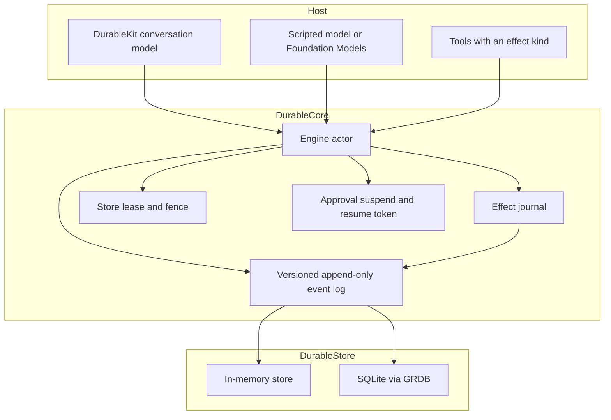

# DurableAgents

DurableAgents makes AI agent runs crash-safe on iPhone, Mac and Linux, in-process, with no server. The event log is the source of truth. A model turn and every tool call are journaled before anything runs, so a killed app resumes from the log instead of asking a model what happened, and a side effect is never sent twice by accident.

## Why use it

- **Side effects are typed.** Each tool declares `pure`, `idempotent`, `transactional` or `external`. After a crash, pure and idempotent tools run again, transactional writes commit with their result, and an external tool calls its `reconcile` hook, or waits for a person, instead of repeating. Most durable agent frameworks only offer "safe to replay or not".
- **Approvals survive restarts.** A run suspends with a resume token, a required auth level (passcode or Face ID), and optional expiry with escalation.
- **Private by construction.** Per-conversation AES-GCM keys wrapped by the Secure Enclave, crypto-shred, PII redaction before the seal, and a hash-chained audit export.
- **Drop-in for Apple's models.** `DurableLanguageModelSession` wraps ordinary FoundationModels tools. It runs on the on-device model, Private Cloud Compute, or any iOS 27 `LanguageModel`.
- **Native Swift 6**, strict concurrency, SQLite through GRDB. Per-conversation locks, so one agent never blocks another.
- **MCP 2026-07-28** client and server, with the official Swift SDK as the fallback for older servers.
- **Coming from pi-durable or PiDurableKit?** `durable-import` copies a pi-durable SQLite file into the event log and reports what it drops.

It is inspired by [Pi](https://github.com/earendil-works/pi) and Pi Durable (MIT, Copyright (c) 2025 Mario Zechner). This is an original Swift redesign, not a port of that codebase, and it is not affiliated with Earendil. Do not call this product Pi.

## Layout

**The durable core.** This is the product.

| Target | Role |
|---|---|
| `DurableCore` | Event log, lease, effect journal, approvals, timers, retries, signals, budgets, and the `ModelStep` protocol. No database and no Apple SDK. |
| `DurableStore` | `EventStore`: in-memory, and SQLite through [GRDB](https://github.com/groue/GRDB.swift). |
| `DurableSecurity` | Encryption at rest, Secure Enclave key wrapping, crypto-shred, redaction, retention. |
| `AgentLoop` | Multi-step loop on the engine: one journaled model checkpoint, parallel safe tools, subagents, forks, compaction. |
| `DurableFoundationModels` | `DurableLanguageModelSession` (a crash-safe `LanguageModelSession`), `DurableTool`, and `FoundationModelsProvider` for Apple's on-device model, Private Cloud Compute, or any iOS 27 `LanguageModel`. On Linux this target is a stub. |
| `DurableKit` | `@MainActor` conversation model for SwiftUI: messages, run status, pending approval, event log. |
| `DurableMCP` | MCP client and server for spec 2026-07-28, with the official Swift SDK (2025-11-25) as the fallback. |
| `durable-audit`, `DurableObserve` | Hash-chain tip, verify, and JSONL/CSV audit export. swift-log spans with scrubbed attributes. |
| `DurableImport`, `durable-import` | One-way importer from a pi-durable SQLite file into the event log. |

**Agent features** built on the core. Small and stable.

| Target | Role |
|---|---|
| `DurableSchedule` | Routines and heartbeat. Quiet hours, catch-up, and a silent ack. |
| `DurableIdentity` | Versioned soul, identity, user, rules, and memory digest. Agent edits stay proposals until a person approves them. |
| `DurableSkills` | `SKILL.md` registry. Scripts are listed as text and are never executed. Agent edits stay proposals. |
| `DurableMemory`, `DurableRetrieval` | Derived index of facts and a knowledge graph. Apple sentence embeddings where available, hash embeddings elsewhere, fused with full-text rank. |
| `DurablePolicy` | Notification quiet hours, daily cap, and dedupe. Approval rules that cannot clear an external effect while unattended. |
| `DurableDelivery` | Journaled webhook, Slack, and APNs delivery with backoff and dead letters. |

**Maintenance only.**

| Target | Role |
|---|---|
| `ModelKit` | Streaming clients for Anthropic Messages, OpenAI Responses, and OpenAI-compatible chat, for Linux, servers and systems before iOS 27. Bug fixes only. On iOS 27 and macOS 27, prefer a `LanguageModel` from Apple or another package through `FoundationModelsProvider(model:)`. |

**Optional app layer.**

| Target | Role |
|---|---|
| `AgentAppKit` | The opinionated layer behind the Assistant app: one engine for many bots, built-in Calendar, Contacts and Reminders tools, bot-to-bot routing, and the small-model workarounds that app needs. Use it as a reference or skip it. No SwiftUI. Tested on Linux. |
| `Apps/Assistant` | Assistant, an iOS 26 / macOS 26 app. Target name `AssistantApp`. Settings → Diagnostics runs one check per module on a device. Not compiled on Linux. |

Test helpers: `CrashProbe` (an executable the tests kill mid-tool) and `mcp-fixture` (a tiny stdio MCP server). Tests use Swift Testing and run on Linux.

Platforms for the libraries: macOS 14+, iOS 17+, and Linux. Swift 6 language mode with strict concurrency. Requires Swift 6.1 or later. GRDB 7.11 needs that toolchain. The Assistant app sets its own deployment target to iOS 26 so it can call Foundation Models. The libraries stay on the lower minimums.

## Architecture



One `Engine` actor is the single writer for a store. Opening it acquires a lease. Every commit carries that fence. A second process is rejected while the lease is held. If the owner dies, or the lease expires, the next opener gets a higher epoch and the old owner’s commits fail.

The log is append-only. Payloads keep the schema version they were written with. Readers upcast. `message.appended` v1 (`{"text"}`) becomes v2 (`messageID`, `role`, `text`) in memory. The stored row stays v1.

A scripted run stores its steps on `run.started`, so recovery does not call a provider. A model-driven run stores `driver: model` and journals each planned step (`model.step.planned`) before executing it. Recovery replays that step. It calls `ModelStep.plan` again only when the plan was not committed. `plan` must not call back into the engine.

## Effect kinds

The engine writes an `effect.intent` before the tool body runs, and writes the raw `effect.result` as soon as the body returns.

| Kind | After a crash between intent and result |
|---|---|
| `pure` | Run the body again. |
| `idempotent` | Run the body again with the same engine key, `fx:<storeID>:<conversationID>:<callID>`. |
| `transactional` | The body’s `StateWrite`s commit in the **same** database transaction as the result. A crash leaves the intent and no write. Recovery runs the body again and commits the write once. |
| `external` | Call `reconcile`. `.done` journals that result and does not run the body again. `.notDone` reruns with the same key. `.unknown` suspends for a human. |

`SimulatedProcessCrash` leaves the intent in place and does not mark the run failed. A normal tool error records the result and fails the run unless `RetryPolicy` schedules another attempt. See [Timers and retry](#timers-and-retry).

## Approval

An `.approval` step writes `approval.requested` and a `ResumeToken`, then returns. The process can exit. A new `Engine` on the same store sees the suspended run and will not continue it until `resume(token:decision:)`.

```swift
let result = try await engine.submit(submission)
guard let token = result.resumeToken else {
    // The script finished or failed without asking for approval.
    fatalError("expected a suspended run")
}
await engine.close()

let restarted = try await Engine(store: store, tools: tools)
_ = try await restarted.recover()
let done = try await restarted.resume(token: token, decision: .approved)
```

Denied approvals fail the run. An external effect that reconciles as `.unknown` uses the same suspend path; resume it with `.approvedWithOutput` so a person supplies the result. An external tool registered with no reconcile hook takes that path on recovery. A tool with `requiresApproval` suspends with purpose `gate` before `effect.intent`. Approving it does not finish the step; the same step then journals the intent and runs the body. High risk asks for `devicePasscode`.

`resume` records `approver` and `authLevel` on `approval.resolved`. A high-risk approval requires at least `devicePasscode`. `biometric` also satisfies that bar. `ApprovalChannel` is how a host is told: `LocalNotificationChannel` builds a notification draft, `PushApprovalChannel` builds an APNs `aps` alert, `WebhookApprovalChannel` posts either a Slack `{"text"}` body or a generic JSON body, and `WebApprovalChannel` keeps an in-app list. An optional webhook `Authorization` header is not written to the log.

Set `WebhookApprovalChannel.durable` or `PushApprovalChannel.destination` to journal the send instead of posting inline. The engine then starts a `durable.deliver` run. Register `DeliveryTool` for that name. See Outbound delivery.

`.approval(..., expiresAt:escalateTo:)` suspends until the engine clock passes `expiresAt`. `pumpTimers` and `recover` then append `approval.escalated`. With `escalateTo`, a new approval is requested for that audience and does not expire again. Without it, the run fails with `approval expired`.

Face ID (`LocalAuthentication`) and Live Activities (`ActivityKit`) live in the app. They are Apple-only and were not compiled here. `ApprovalAppleSupport` reports those imports as unavailable on Linux.

## Inbox

`submit` is exactly-once for a `requestID` inside one conversation. The payload hash is SHA-256 of the text and the script. The same id and the same hash returns the original submission. The same id and a different hash throws `DurableError.requestIDConflict`. A second id while a run is suspended is queued and starts after that run finishes.

## Identity

`DurableIdentity` stores `SOUL.md`, `IDENTITY.md`, `USER.md`, `AGENTS.md`, and `MEMORY.md` as journaled documents. `replace` is a person editing. `propose` is the agent, capped at five proposals an hour for each layer, and it does not change the prompt. `decide` is the only way a proposal becomes the current text. `revert` copies an older version forward. `assemble` packs the layers into a system prompt, skips bootstrap in light context, and marks a clipped layer with `[truncated]`. Put `AssembledPrompt.system` in `AgentLoopStep.instructions`. The `audit` value lists the layer versions that were used. Encryption is the event-store wrapper, not a second cipher in this module.

## Skills

`DurableSkills` parses `SKILL.md` leniently and records warnings instead of failing the file. A skill name is at most 64 characters of `[a-z0-9-]`. `install` is a person adding a skill. `propose` is the agent, capped at five proposals an hour for that name, and it does not replace the installed text. `decide` is the only promotion. An empty proposal file map keeps the previous files, so a text edit does not wipe `scripts/` or `references/`. `allowed-tools` narrows the tools the skill may name; it never grants a tool that is not already registered. Files under `scripts/` are stored and returned with `executable: false`. There is no subprocess and no JavaScript sandbox. `skill.activate` and `skill.read_resource` are pure tools that read the journal. They do not call the engine.

## Memory

`DurableRetrieval` embeds text with `ContextualEmbedder` (Apple's `NLContextualEmbedding`, token vectors mean-pooled and normalized) when the model is on the device, and with `HashEmbedder` otherwise, including on Linux. `Embedders.preferred()` picks one and can download the model first. Each vector records its embedder id, so `MemoryIndex.use(_:)` can switch embedders and rows made by another embedder are re-embedded, never compared. Search fuses full-text rank with vector rank through `RetrievalMath.fuse` (reciprocal rank fusion, `k = 60`), so exact names still match. `BruteForceVectors` is the index.

`DurableMemory` rebuilds a GRDB file from `state.wrote` events. The sqlite file is a derived index, not a second ciphertext. Emails become `[redacted-email]` and `sk-…` tokens become `[redacted-secret]` before they are stored. Search mixes FTS5 with cosine and fuses the two lists. `memory.remember` and `memory.forget` are transactional: they return `StateWrite`s and do not write SQLite themselves. `memory.search` and `memory.open` are pure and rebuild from the log first. `shred` and `decay` journal tombstones, then rebuild.

When `DurableMCPServer` is created with a `MemoryIndex`, it also exposes `create_entities`, `create_relations`, `add_observations`, `delete_entities`, `delete_observations`, `delete_relations`, `read_graph`, `search_nodes`, and `open_nodes`. Those handlers append to the log and rebuild. Do not call them from a tool on the same engine.

## Notification and approval policy

`DurablePolicy` decides whether a local notification is shown and whether a tool call still needs a person. `NotificationPolicy` checks quiet hours first (the same `QuietHours` window as routines: outside it, nothing is sent and the daily cap is not spent), then a dedupe key, then a daily cap counted in that time zone. The decision carries a collapse id. `ApprovalPolicy` takes the first matching rule. A rule can force approval, including by argument and time of day. Unattended mode never auto-approves an external effect, even when a rule says to and even when the tool flag does not require approval. An attended rule may still auto-approve. Rulings are `notification.decided` and `approval.policy` on the `policy` stream, each with a rule id. The engine's own gate is still `Tool.requiresApproval`. Call the journal from the host, not from inside a tool. Assistant uses this for routine notifications and writes an unattended ruling before each catch-up.

## Assistant app

`Apps/Assistant` is a multiplatform SwiftUI app. The Xcode target is `AssistantApp`. It is not part of `swift test`. Open the project on a Mac with Xcode 26. See `Apps/Assistant/UNVERIFIED.md` and `Apps/Assistant/APP_STORE.md`.

`AgentAppKit` is the part that `swift test` covers: one engine for many agents, builtin tools, the approval inbox, illustrative usage, crypto-shred, and a loopback MCP listener on macOS and Linux. Settings → Diagnostics in the app runs one check per module on a device.

## Routines

`DurableSchedule` journals `routine.defined`, `routine.fired`, and `routine.skipped`. A firing uses `requestID = routine:<id>:<slot>` so a second tick does not start a second run. `heartbeat.respond` (OpenClaw's `heartbeat_respond`) returns `noReply`, `notify`, or `updateChecklist`. `noReply` does not schedule a notification. Quiet hours, an empty checklist, a busy engine, a budget failure, and a too-soon event are skipped and written to the log. `runLatest` runs the newest missed slot. `skipMissed` drops a gap. `runAll` runs at most eight. The Apple wake helper is `AppleRoutineWake`, compiled only where BackgroundTasks and UserNotifications exist. It schedules a best-effort refresh. It does not promise a 30-minute cadence. On iOS 27 it submits through `submitTaskRequest`, which reports every rejection, and through `submit` on earlier systems.

## Timers and retry

Pass a `TimerPump` as the engine's `timers` and call `attach(engine)` after creating it. The pump fires journaled timers, such as a retry after a failed tool, while the process runs. Timers missed while the process was closed fire from `recover` and `pumpTimers`.

`RetryPolicy` is stored on `run.started`. `stub` allows one attempt, so a thrown tool error still fails the run. That is still the engine default. `RetryPolicy.standard` is the opt-in schedule: five attempts, half a second doubling, 20% jitter. A policy with more attempts retries `pure`, `idempotent`, and `transactional` tools with exponential backoff and optional jitter, and journals `effect.retry` plus a timer. `external` is never retried automatically; recovery still calls `reconcile`. A tool that throws `DeliveryRetry` is the exception: a retryable failure uses the run's schedule (or the receiver's `Retry-After`), and a non-retryable failure or an exhausted schedule writes `delivery.deadLettered`.

`requestTimer(name:fireAt:)` appends `timer.requested`. `Engine.pumpTimers()` and `recover()` append `timer.fired` when the engine clock is past the deadline, then continue the run. Pending timers are re-registered with `TimerScheduling` and `BackgroundWakeScheduling` after a restart. On Apple, `BGTaskSchedulerWake` submits a `BGAppRefreshTaskRequest`; the journal remains the source of truth.

Script steps `.sleepUntil` and `.waitSignal` suspend the run. `Engine.signal(_:payload:)` resumes a waiting signal, and a signal that arrives first is kept until the wait starts.

## Outbound delivery

`DurableDelivery` sends a journaled effect of kind `external`. Reconcile returns `.notDone`, so a crash after `effect.intent` and before `effect.result` posts again with the same engine key. That key is the `Idempotency-Key` header and the `delivery-id` field on webhook and Slack bodies. APNs does not get `Idempotency-Key`. The documented `apns-id` header is a UUID derived from the key, and the payload also carries `delivery-id`.

Retry when the error is a network failure, HTTP 429, or HTTP 5xx. Honor `Retry-After` (delta-seconds or an HTTP date) when it is present; otherwise use the run's backoff. Do not retry other 4xx. After the last attempt, or immediately on a refused status, the run records `effect.result` with `ok: false`, `delivery.deadLettered`, and `run.failed`. The dead-letter payload has the key, the reason, the attempt count, and the status. It does not include the request body or any secret.

Delivery runs started from an approval channel use `RetryPolicy.standard` even if the engine was created with `stub`. A host that calls the tool from its own script uses the engine's policy, so pass `.standard` when that script should retry. `stub` still dead-letters a `DeliveryRetry` after one try.

Generic webhooks are signed with HMAC-SHA256. `X-Timestamp` is unix seconds. `X-Signature` is `v1=` plus the hex of HMAC-SHA256(secret, `"<timestamp>.<raw body>"`). The body is canonical JSON, and the signature covers those exact bytes, including `delivery-id`. Verifiers should reject a timestamp outside a few minutes. The signing secret is a secret-account name (`signingSecretAccount`), resolved at send time, and is not journaled. The same is true of `authorizationSecretAccount` and of a Slack URL stored under `webhookSecretAccount`. Slack incoming webhooks are not signed; their documented body is `{"text":"..."}` plus our `delivery-id`. Do not put a Slack URL that contains the token in the journal.

APNs uses token auth. The JWT header is `alg` `ES256` and `kid`. The claims are `iss` and `iat`. The `.p8` key is PKCS#8 PEM loaded from `authKeyAccount`. Request headers follow Apple's current token-auth API: `authorization: bearer <jwt>`, `apns-topic`, `apns-push-type`, `apns-id`, and `apns-priority` (`10` for `alert`, `5` for `background`). The host is `api.push.apple.com` or `api.sandbox.push.apple.com`. `APNsLiveSender` uses `URLSession` HTTP/2 and is compiled only on Apple. Linux Foundation is HTTP/1.1, so `APNsSupport.liveSenderCompiled` is false there and a live send throws. The JWT builder, the request builder, and a stubbed HTTP transport are what the Linux tests exercise. The live Apple sender was not compiled or verified in this environment.

## MCP

`DurableMCP` speaks MCP **2026-07-28** natively and keeps the official [Swift SDK](https://github.com/modelcontextprotocol/swift-sdk) (package `swift-sdk`, product `MCP`, 2025-11-25) as a fallback for older servers. With `protocolVersion: "automatic"` (the default) the client probes with `server/discover`. A modern server is then used statelessly: every request carries the protocol version, `clientInfo` and `clientCapabilities` in `_meta`, and HTTP POSTs send `MCP-Protocol-Version`, `Mcp-Method` and `Mcp-Name` headers. If the probe gets a reply that is not a recognized modern error, the client falls back to the SDK's `initialize` handshake.

`tools/call`, `resources/read` and `prompts/get` follow multi round-trip requests: an `input_required` result is answered through an `MCPInputHandler` (elicitation only; sampling and roots are deprecated and not offered), and the retry echoes `requestState`. List and read results are cached for `ttlMs` and invalidated by events from `subscriptions/listen` (`MCPClientSession.listen`). With the tasks extension, a task result is polled with `tasks/get`. With an `MCPTaskJournal` the task id is recorded before polling, so a crash resumes polling the same task instead of calling the tool again, and a task waiting on input after a crash suspends the run for a person. Every tool call sends `_meta["dev.durableagents/idempotencyKey"]`, a hash of the engine effect key that is the same on every retry. The spec defines no idempotency field, so a server has to opt in to deduplicate on it.

Not covered yet: OAuth, completion, progress and log notifications, the deprecated HTTP+SSE transport, MCP Apps, and resources or prompts served by `DurableMCPServer`.

| Hint | Effect | Approval |
|---|---|---|
| `readOnlyHint: true` | `pure` | no |
| `idempotentHint: true` (and not read-only) | `idempotent` | no |
| `destructiveHint: true` | `external`, no reconcile | yes, risk `high` |
| hints absent, or not read-only and not idempotent | `external`, no reconcile | yes, risk `standard` |

A server config file can override `effect`, `approval`, `risk`, and `replayOnCrash` per remote tool name. Set fields win. `replayOnCrash: true` installs a reconcile hook that returns `.notDone`, so a crash runs the same call again. Otherwise an external MCP tool has no reconcile hook: recovery suspends for a human or a later model-guided decision instead of calling the server again.

Each exposed tool is named `mcp.<server>.<tool>`. `allow` is a per-server allowlist of remote names. An empty allowlist exposes nothing. The input schema is copied onto the engine tool so the model can see it. Intent and result are journaled like any other tool. Text content is stored. Image and audio bytes are not. Redaction and encryption apply when the store is wrapped with `EncryptingEventStore`.

Auth is secret-account names: `envSecrets` for stdio environment variables, `headerSecrets` for HTTP headers. The value is resolved at connect time and is not written to the journal or to error text. A missing account fails with `missing secret account <name>`.

stdio uses `Foundation.Process` on macOS and Linux. It is not available on iOS (`MCPPlatform.stdioAvailable`). Streamable HTTP is a JSON POST through `HTTPClientTransport` with SSE turned off, so the same client runs on Linux and on iOS. The SDK's SSE client is compiled only off Linux and was not exercised here (`MCPPlatform.sseStreamingCompiled` is false on Linux). Calls check cancellation, honor `timeoutSeconds`, and open one new connection after an MCP `connectionClosed` error. Other MCP errors are not retried. SDK failures are rethrown as `MCPCallError` with a fixed sentence so a URL or token in `localizedDescription` cannot reach the journal.

`DurableMCPServer` answers both eras: `server/discover` and stateless 2026-07-28 requests, and the SDK's `initialize`. It exposes the engine to other clients (Claude, Cursor, a LangGraph back office). Tools: `start_run`, `send_message`, `get_run_status`, `list_pending_approvals`, `approve`, `reject`, `export_audit`. Pass a `MemoryIndex` to also expose the knowledge-graph tools (`create_entities`, `create_relations`, `add_observations`, `delete_entities`, `delete_observations`, `delete_relations`, `read_graph`, `search_nodes`, `open_nodes`). `approve` and `reject` require `approverId` and `authLevel` (`anonymous`, `session`, `devicePasscode`, `biometric`). The server allowlist is a set of approver ids; an empty set refuses every approval. The engine still rejects an auth level below the approval's requirement. `export_audit` is `AuditExport.jsonl`, which omits message text and tool arguments. stdio and stateless streamable HTTP (POST JSON, GET 405) are both wired. Do not call this server from a tool on the same engine. The tool runs while the engine holds its lock.

### MCP security

MCP tool descriptions and results are untrusted input. A hostile or compromised server can poison a later prompt (tool poisoning, prompt injection) by putting instructions in a description or a tool result. Treat annotations as hints, not as proof: the spec says clients should not make safety decisions from annotations received from an untrusted server. This mapping is a default for servers you chose to configure, not a guarantee.

Keep a per-server allowlist. Do not point a run at a server and expose every tool it lists. Destructive tools, and tools with no hints, require approval before the effect is journaled. High-risk approvals need `devicePasscode` or `biometric`. Prefer a config override when you know a tool is read-only or idempotent, and leave `replayOnCrash` off unless the server dedupes on something you control. The engine does not send an idempotency key on MCP calls. Secret values stay in the secret store. Config files store account names only.

## Model steps

`ModelStep.plan` returns the same step vocabulary as a script: assistant text, a tool call, an approval, or finish. `ScriptedModelStep` walks a fixed list. `submitTurn` is the model-driven entry point. `submit(Submission)` is unchanged.

`FoundationModelsProvider` is compiled only when `FoundationModels` is importable. It opens a `LanguageModelSession` with capturing tools. Those tools record the arguments and throw before any side effect. The session surfaces that as `LanguageModelSession.ToolCallError`, and the engine then journals `effect.intent` and runs the real DurableAgents tool. A crash still reconciles from the journal, not from the model.

On iOS 27 and macOS 27, `FoundationModelsProvider(model:instructions:)` takes any `LanguageModel`, so a third-party model that conforms to Apple's protocol runs through the same durable loop. Those larger models get the history as a structured `Transcript` (prompts, responses, tool calls, tool outputs). Apple's small on-device model keeps a flat "role: text" prompt, because in testing on macOS 27 it called tools more reliably that way.

### Drop-in durable session

`DurableLanguageModelSession` wraps an ordinary FoundationModels tool set so a chat survives a crash:

```swift
let session = try await DurableLanguageModelSession(
    store: try SQLiteEventStore(path: url.path),
    instructions: "You save notes when asked.",
    tools: [DurableTool(SaveNote(), effect: .external, requiresApproval: true)]
)
_ = try await session.recover()   // at launch: finish an interrupted turn, report a pending approval
switch try await session.respond(to: "Save a note that says buy milk.") {
case .text(let reply): print(reply)
case .needsApproval(let prompt, let token): // ask the person, then
    _ = try await session.approve(token)
case .retrying, .failed: break
}
```

`DurableTool` keeps your tool's name, description and `@Generable` arguments, and adds the effect kind, approval, and reconcile hook. The tool body runs only after the engine has journaled the call, so a killed app does not send twice. If the model declines to word a reply after a tool succeeded (the on-device guardrail sometimes does), the session answers with the tool's own result.

Each plan uses a new session. The prompt is rebuilt from the durable transcript, because a tool error rolls the Foundation Models transcript back. Check `SystemLanguageModel.default.availability` before using it. `.available` uses the on-device model. `.unavailable(.appleIntelligenceNotEnabled)`, `.unavailable(.deviceNotEligible)`, `.unavailable(.modelNotReady)`, and any other unavailable reason fall back to a scripted model. `ScriptedModelStep` is the scripted fallback.

### On-device limits

Apple's on-device foundation model has a context window of **4096 tokens per session**. Instructions, the prompt, tool names, descriptions, parameter schemas, and guided-generation guides all count. `LanguageModelError.contextSizeExceeded` stops the session when that window is exceeded. `FoundationModelsProvider` keeps the instructions short and sends only the most recent messages, clipped to a character budget, into a fresh session. `SystemLanguageModel.contextSize` and `tokenCount(for:)` are the APIs to measure a prompt on device.

On iOS 27 and macOS 27, `FoundationModelsProvider(privateCloud: true)` runs on Apple's `PrivateCloudComputeLanguageModel` instead. The prompt budget follows that model's `contextSize`, so more history fits. The request leaves the device, so `OnDevicePolicy.blocksCloud` treats `ProviderChoice.applePrivateCloud` as a cloud choice. It needs Apple's managed `com.apple.developer.private-cloud-compute` entitlement, which a developer requests from Apple. Without it the framework stops the process with a fatal error rather than throwing, so the provider only calls it when the app's Info.plist sets `DurableAgentsPrivateCloudEntitled` to true, and otherwise stays on device. `FoundationModelsSupport.privateCloudAvailable` checks that key and whether the model can answer now.

## Model providers (`ModelKit`)

ModelKit is in maintenance: bug fixes only, no new providers or request features. It exists for Linux, servers, and systems before iOS 27. On iOS 27 and macOS 27, Apple's `LanguageModel` protocol is the integration point: pass any conforming model to `FoundationModelsProvider(model:instructions:)` or `DurableLanguageModelSession(store:model:instructions:tools:)`.

`ModelKit` does not import the durable kernel. A `ModelProvider` yields `ModelStreamEvent` values (`textDelta`, `thinkingDelta`, `toolCallDelta`, `toolCall`, `usage`, `stop`). Token deltas stay in memory. `complete` folds them into one `ProviderTurn`, which is the checkpoint a durable loop should journal.

| Type | Endpoint |
|---|---|
| `AnthropicMessages` | `POST /v1/messages` with `x-api-key` and `anthropic-version: 2023-06-01` |
| `OpenAIResponses` | `POST /v1/responses` with `Authorization: Bearer` |
| `OpenAICompatibleChat` | `POST {base}/v1/chat/completions` for OpenAI, xAI, Groq, OpenRouter, and Ollama |

API keys are `SecretReference` values (an account name), resolved by `SecretStore`. `EnvironmentSecretStore` reads the process environment. `KeychainSecretStore` is compiled only where Security is available. The key is sent as a header and is not written into the JSON body. An empty secret on the chat provider omits `Authorization` for local servers. `ScriptedProvider` replays a fixed event list for tests.

## Agent loop (`AgentLoop`)

`AgentLoopStep` is a `ModelStep`. It asks a `ModelProvider` for one complete turn and returns that turn to the engine, which journals it before any tool runs. Pure and idempotent calls from the same turn run at the same time. Transactional and external calls run one at a time, and an external replay still calls `reconcile`. A tool name listed in `subagentTools` starts a child conversation on the same engine instead of running a tool body. `Engine.fork` copies the transcript into a new conversation with new message ids and records `forkedFrom` on `conversation.opened`.

When the prompt grows past `compactAfterMessages`, the step journals `context.compacted` with a model-written summary. The original messages stay in the log. Later prompts see the summary plus the most recent messages.

`FoundationModelsProvider` adapts Apple's `LanguageModelSession.streamResponse(to:)` to the same `ModelProvider` loop. Each snapshot is sent as a text delta, so the reply shows while the model generates. It is compiled only when Foundation Models is available. The cloud providers stream server-sent events as they arrive. `PublishingProvider` copies text deltas into `LiveTranscript` for the UI. Only the finished turn is journaled.

## Security (`DurableSecurity`)

`EncryptingEventStore` wraps any `EventStore`. It redacts payloads, then seals them with AES-GCM (swift-crypto, the same API as CryptoKit). The engine and `read` see plaintext. The inner log stores ciphertext. Keys come from `ConversationKeyProvider` (`MemoryKeyProvider`, `FileKeyProvider`, and `KeychainKeyProvider` and `SecureEnclaveKeyProvider` where Security is available). `shred` deletes the key so the ciphertext cannot be opened.

`SecureEnclaveKeyProvider` stores each conversation key wrapped by a P-256 key that lives in the Secure Enclave: an ephemeral P-256 key, ECDH, HKDF-SHA256 with the conversation scope as info, then AES-GCM. The enclave key needs no user presence and is readable after first unlock, so background wakes still decrypt while the phone is locked. A plain key from `KeychainKeyProvider` is wrapped in place on first read, or all at once with `wrapExistingKeys()`, and keeps its bytes. A wrapped item that does not open throws `keyUnavailable`. It is never replaced with a new key. Without an enclave (simulator, Linux) it behaves like `KeychainKeyProvider`.

`BuiltInRedactor` runs before that seal. It matches SSNs, Luhn-valid card numbers, labeled account and routing numbers, emails, phone numbers, `Authorization: Bearer` values, `sk-` tokens, and `x-api-key` values. Extra patterns can be added. With a `TokenVault`, the replacement is a token and the secret stays in the vault, not the log.

`Retention.purge` rewrites expired payloads for the selected event types to `{"purged": true}` and appends `retention.purged`. Sequence numbers stay. A stream with `retention.hold` set is skipped.

## Observability

`Engine` accepts a `RunTracing` hook. Each `advance` opens a `run` span, each model plan opens `model.plan`, and each tool body opens `effect`. Attributes are conversation ids, step indexes, call ids, tool names, effect kinds, and status. `SpanScrub` drops keys such as `prompt`, `text`, `payload`, and `authorization`, and replaces secret-shaped values. `NoOpTracing` is the default. `LoggingTracer` in `DurableObserve` writes the same spans through swift-log.

`EventHashChain` hashes each stored envelope with the previous digest (sequence, stream, type, schema, time, canonical payload). `durable-audit tip --database agent.sqlite` prints the tip. `verify --expect <tip>` exits non-zero when the tip differs or a sequence has a hole. Deleting the tail keeps the remaining sequences contiguous, so record the tip if you need to detect that. The chain covers the bytes in the file. An encrypted log is hashed as ciphertext.

`durable-audit export --format jsonl` or `csv` lists `effect.intent`, `effect.result`, `approval.requested`, and `approval.resolved` with ids, tool name, outcome, and approver. Message text and tool arguments are not columns.

## Importing a pi-durable database

`durable-import` reads schema version 1 from `@earendil-works/pi-durable` (`packages/durable/src/storage/sqlite/migrations.ts` on the main branch of earendil-works/pi). The eight domain tables are `durable_metadata`, `record_ids`, `conversations`, `entries`, `tasks`, `submissions`, `documents`, and `document_revisions`. `durable_schema` is the version row.

```bash
swift run durable-import --source session.sqlite --destination events.sqlite
```

User, assistant, and tool-result entries become `message.appended`. Compaction becomes `context.compacted`. Tool calls, tasks, submissions, and document bases become `import.note`. The command prints a loss report. It does not copy the id allocator, fork history by pointer, Chord deltas, images, thinking blocks, live task checkpoints, or memos. A live task is not resumed. A newer schema version is refused. Tool calls are not `effect.intent` rows, so opening the log does not rerun them.

## DurableKit

`ConversationModel` is a `@MainActor` class. When the Observation module is present it is also `@Observable`. It exposes `messages`, `status` (`idle`, `running`, `suspendedForApproval`, `failed`, `done`), `pendingApproval`, the `events` array, and `eventLog` (an `AsyncStream` of envelopes observed after the model is opened). `send` starts a model turn. `approve` and `reject` resume the pending token. `recoverOnLaunch` continues a running journal and reloads a suspended one. `close` drops the lease, which in-process tests need because the pid is still alive.

## Build and test on a Mac

Install a Swift 6.1+ toolchain. Xcode 26 is required to compile the Assistant app and Foundation Models. The package tests do not need that SDK:

```bash
swift test
swift build
```

`swift test` builds `CrashProbe`, kills it mid-tool, and recovers that SQLite file in the test process. It also restarts a second process for approval suspend and resume, and it runs the DurableKit tests against `ScriptedModelStep` and a scripted escrow planner kept in the tests.

To run the package suite in Xcode, open `Package.swift`, wait for package resolution, and choose **Product > Test**. To run the app, open `Apps/Assistant/Assistant.xcodeproj` instead.

Formatting is [swift-format](https://github.com/swiftlang/swift-format) with the `.swift-format` file in the repo root. SwiftLint is not used. No GitHub Actions workflow is required to build or test.

On Linux, install `libsqlite3-dev`, `sqlite3` (the importer tests use it), a C++ toolchain (`g++` or `libstdc++-dev`, required to build swift-crypto), and a Swift 6.1+ toolchain, then run the same `swift test`.

```bash
swift run durable-audit tip --database events.sqlite
swift run durable-audit verify --database events.sqlite --expect <tip>
swift run durable-audit export --database events.sqlite --format jsonl
swift run durable-import --source session.sqlite --destination events.sqlite
```

## Short example

```swift
import DurableCore
import DurableKit
import DurableStore

let store = InMemoryEventStore(storeID: "dev")
let echo = Tool(name: "echo", effect: .pure) { input, _ in
    ToolReturn(output: input)
}
let engine = try await Engine(store: store, tools: [echo])
let result = try await engine.submit(Submission(
    requestID: "req-1",
    text: "Say hello and echo a token",
    script: Script(steps: [
        .assistant("Hello."),
        .tool(name: "echo", callID: "c1", arguments: .string("token-1")),
        .finish("done"),
    ])
))
// result.runStatus == .completed, result.finalText == "done"

let model = try await ConversationModel.open(
    store: store,
    tools: [echo],
    model: ScriptedModelStep(steps: [
        .tool(name: "echo", callID: "c1", arguments: .string("token-1")),
        .finish("done"),
    ]),
    backendLabel: "script"
)
try await model.send("Echo a token")
```

SQLite is `try SQLiteEventStore(path: "agent.sqlite")`. The same `Engine` API talks to either store.

## Design choices

These follow the redesign notes, not a table-compatible port of Pi Durable:

- The journal is the source of truth. `durable-import` copies a pi-durable SQLite file in one direction and reports what it drops. The tables are not the runtime format.
- The fence is store-wide. Each conversation has its own lock inside the engine, so one agent's model call or tool body does not hold up another agent. Recovery, timer pumps and signals take every lock. Reads and single appends take none. A subagent call never waits for another conversation's lock: a busy target answers that it is busy, so two agents asking each other cannot deadlock. Group commit is later work.
- The engine keeps its folded view of the log in memory and reads only events after the last one it applied (`EventStore.readAll(after:)`), so a step costs what changed rather than the whole history. Through `EncryptingEventStore` that also means only new events are decrypted. A `retention.purged` event makes it refold from the start, and a new engine folds the log once at open. `Engine.reloadState()` drops the fold after stored events change outside the engine.
- Transactional tools do not run inside an open SQLite transaction callback. Their writes are returned to the engine and committed with the result, which is the atomic boundary.
- Encryption, redaction, and retention wrap the log. Tracing is a hook, not an OpenTelemetry SDK export.
- Transcript messages are a small versioned JSON shape owned here. They are not the Pi message schema.

## License

MIT. See [LICENSE](LICENSE).

Pi and Pi Durable are MIT, Copyright (c) 2025 Mario Zechner, <https://github.com/earendil-works/pi>. They are an inspiration only. GRDB is MIT.
