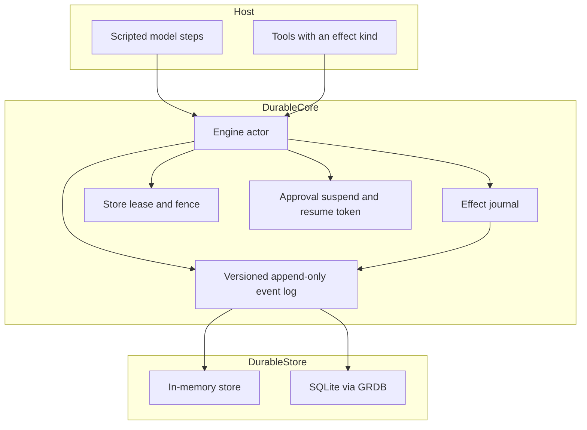

# DurableAgents

Working name: **PiSwift**.

DurableAgents is a Swift-native durable execution kernel for agent runs. The event log is the source of truth. A conversation runs under a single-owner lease, tool calls declare what kind of side effect they are, and a crash resumes from the journal instead of asking a model what happened.

This repository is the first milestone: the durable core, storage, and tests. It does not call LLM providers.

It is inspired by [Pi](https://github.com/earendil-works/pi) and Pi Durable (MIT, Copyright (c) 2025 Mario Zechner). This is an original Swift redesign, not a port of that codebase, and it is not affiliated with Earendil. Do not call this product Pi.

## Layout

| Target | Role |
|---|---|
| `DurableCore` | Event log, lease, effect journal, scripted run loop. No database and no AI SDK. |
| `DurableStore` | `EventStore`: in-memory, and SQLite through [GRDB](https://github.com/groue/GRDB.swift). |
| `CrashProbe` | Small executable the tests kill or restart against a real SQLite file. |
| `DurableAgentsTests` | Swift Testing. |

Later milestones can add `PiAI`, `PiAgent`, and `DurableKit` beside these targets. They are not in this package yet.

Platforms: macOS 14+, iOS 17+, and Linux. Swift 6 language mode with strict concurrency. Requires Swift 6.1 or later (Xcode 16.3 or later). GRDB 7.11 needs that toolchain. iOS apps can sit on a newer SDK; the core stays at these minimums.

## Architecture



One `Engine` actor is the single writer for a store. Opening it acquires a lease. Every commit carries that fence. A second process is rejected while the lease is held. If the owner dies, or the lease expires, the next opener gets a higher epoch and the old owner’s commits fail.

The log is append-only. Payloads keep the schema version they were written with. Readers upcast. `message.appended` v1 (`{"text"}`) becomes v2 (`messageID`, `role`, `text`) in memory. The stored row stays v1.

A run is a script of assistant text, tool calls, approval waits, and a finish step. The script is stored on `run.started`, so recovery does not call a provider. Replace the script with a real model step in a later `PiAI` target.

## Effect kinds

The engine writes an `effect.intent` before the tool body runs, and writes the raw `effect.result` as soon as the body returns.

| Kind | After a crash between intent and result |
|---|---|
| `pure` | Run the body again. |
| `idempotent` | Run the body again with the same engine key, `fx:<storeID>:<conversationID>:<callID>`. |
| `transactional` | The body’s `StateWrite`s commit in the **same** database transaction as the result. A crash leaves the intent and no write. Recovery runs the body again and commits the write once. |
| `external` | Call `reconcile`. `.done` journals that result and does not run the body again. `.notDone` reruns with the same key. `.unknown` suspends for a human. |

`SimulatedProcessCrash` leaves the intent in place and does not mark the run failed. A normal tool error records the result and fails the run. Retry is not scheduled in this milestone.

## Approval

An `.approval` step writes `approval.requested` and a `ResumeToken`, then returns. The process can exit. A new `Engine` on the same store sees the suspended run and will not continue it until `resume(token:decision:)`.

```swift
let result = try await engine.submit(submission)
guard let token = result.resumeToken else {
    // The script finished or failed without asking for approval.
    fatalError("expected a suspended run")
}
await engine.close()

let restarted = try await Engine(store: store, tools: tools)
_ = try await restarted.recover()
let done = try await restarted.resume(token: token, decision: .approved)
```

Denied approvals fail the run. An external effect that reconciles as `.unknown` uses the same suspend path; resume it with `.approvedWithOutput` so a person supplies the result.

## Inbox

`submit` is exactly-once for a `requestID` inside one conversation. The payload hash is SHA-256 of the text and the script. The same id and the same hash returns the original submission. The same id and a different hash throws `DurableError.requestIDConflict`. A second id while a run is suspended is queued and starts after that run finishes.

## Timers and retry

`RetryPolicy.stub` is stored on `run.started`. The engine does not sleep or retry a failed step. `requestTimer(name:fireAt:)` appends `timer.requested` and calls `TimerScheduling`. The default scheduler does nothing. There is no OS wake-up hook yet.

## Build and test on a Mac

Install Xcode 16.3 or newer, or a Swift 6.1+ toolchain, and use the project directory:

```bash
swift test
swift build
```

`swift test` builds `CrashProbe`, kills it mid-tool, and recovers that SQLite file in the test process. It also restarts a second process for approval suspend and resume.

To run the same suite in Xcode, open `Package.swift`, wait for package resolution, and choose **Product > Test**.

Formatting is [swift-format](https://github.com/swiftlang/swift-format) with the `.swift-format` file in the repo root. SwiftLint is not used. No GitHub Actions workflow is required to build or test.

On Linux, install `libsqlite3-dev` and a Swift 6.1+ toolchain, then run the same `swift test`.

## Short example

```swift
import DurableCore
import DurableStore

let store = InMemoryEventStore(storeID: "dev")
let echo = Tool(name: "echo", effect: .pure) { input, _ in
    ToolReturn(output: input)
}
let engine = try await Engine(store: store, tools: [echo])
let result = try await engine.submit(Submission(
    requestID: "req-1",
    text: "Say hello and echo a token",
    script: Script(steps: [
        .assistant("Hello."),
        .tool(name: "echo", callID: "c1", arguments: .string("token-1")),
        .finish("done"),
    ])
))
// result.runStatus == .completed, result.finalText == "done"
```

SQLite is `try SQLiteEventStore(path: "agent.sqlite")`. The same `Engine` API talks to either store.

## Design choices

These follow the redesign notes, not a table-compatible port of Pi Durable:

- The journal is the source of truth. There is no copy of Pi Durable’s eight tables, and no importer yet.
- The fence is store-wide. One actor serializes runs. Per-conversation commit lines and group commit are later work.
- Transactional tools do not run inside an open SQLite transaction callback. Their writes are returned to the engine and committed with the result, which is the atomic boundary.
- Encryption, redaction, retention, and OpenTelemetry are not in this milestone.
- Transcript messages are a small versioned JSON shape owned here. They are not the Pi message schema.

## License

MIT. See [LICENSE](LICENSE).

Pi and Pi Durable are MIT, Copyright (c) 2025 Mario Zechner, <https://github.com/earendil-works/pi>. They are an inspiration only. GRDB is MIT.
